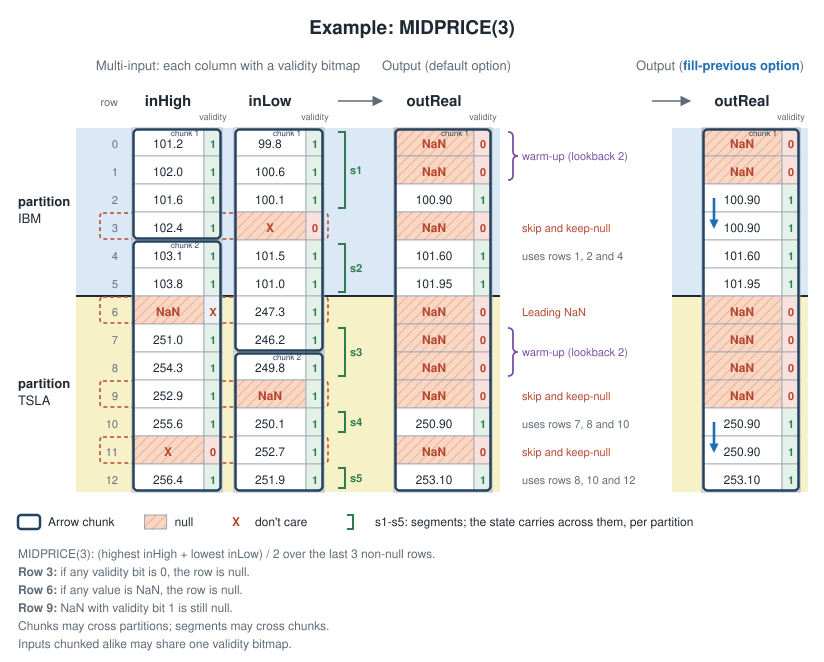

# RFC: TA-Lib Arrow API

Status: draft, for discussion.

Last Update: 2026-11-09

## Summary

Two layers:

- **Arrow API**: a Python facade that takes and returns Arrow arrays, and a C
  helper that exports results as Arrow arrays.
- **Segmented batch**: one new entry per function, in C and Rust, that reads
  Arrow arrays in place, in one chunk or several. C reads the Arrow C Data
  Interface struct; Rust reads a safe view of the same layout. A caller without
  Arrow (NumPy, plain C) wraps its buffer in one.

TA-Lib depends on no Arrow library.

## Motivation

**Missing values inside a series.** Today a NaN or infinity in the input is
unsupported and not detected. Wrappers pass a missing value as NaN, and
functions react differently: some propagate NaN, some recover, and some (RSI
among them) return wrong finite values for every later bar. So every table
library guards against it in its own way, and no two agree on what follows a
gap.

**Many short series per call.** The common table workload is a panel: one
column with many symbols, computed per symbol (`.over("symbol")` in Polars,
`groupby(...).transform(...)` in pandas). Today each symbol is a separate call,
and the call costs far more than the computation. Under callgrind, on a Polars
plugin (ATR, 20-row groups), a call retires about 32,700 instructions, of which
the kernel and its entry are about 600. Only fewer calls can save the rest.

A wrapper could solve both itself. Solving them in the TA-Lib C and Rust Core
gives every wrapper the same result, tested once.

## Terms

- **Partition.** A range of consecutive rows computed independently, such as
  one symbol in a panel.
- **Column.** One input, as one or more Arrow arrays (chunks).
- **Validity.** Arrow's null bitmap: one bit per row, set when the row is
  valid.
- **Segment.** A run of valid, finite rows in a partition, between nulls or the
  partition's ends. It may span chunks. Core finds segments; the caller never
  passes them.



## Semantics

- **Skip on null.** A null input row is skipped, and the state carries across
  it.
- **Output control.** On a null input row, `keep-null` (the default) makes the
  output null; `fill-previous` repeats the previous output. A filled output
  copies the previous output, validity included; once the partition has an
  output, a pattern-recognition output is filled with a valid 0 instead. With no
  previous output in the partition, the row is null. The lookback (warm-up)
  period always outputs null.
- **Partitions.** Nothing carries from one partition to the next.
- **Non-finite is null.** A NaN or infinite input makes its row null, so no
  calculation uses it, and a non-finite result makes its row null. Arrow
  treats NaN as a value, not a null; TA-Lib does not, because a non-finite
  price is never usable.
- **Alignment.** Output row `i` belongs to input row `i`.
- **Validity on multi-input.** A row is null when any input is null there, such
  as a missing low in a price bar. All outputs are null on the same rows and
  share one bitmap. A null output holds NaN, or 0 in an integer output; since 0
  is also a valid integer (a candlestick with no pattern), only the bitmap tells
  them apart.

To restart the calculation after a null instead, as pandas and Polars rolling
windows do, start a new partition at the first valid row after the null (after
the last null of a run).

### Chaining

An output's validity serves as the next call's input validity, so calls chain
directly. Whatever the output option, the result is deterministic: a NaN no
longer causes undefined behavior.

## Segmented batch

The caller owns these structs. They only point at its data; Core allocates
nothing for them and keeps nothing after the call.

```c
typedef struct TA_Column {
   const struct ArrowSchema       *schema;   /* NULL means float64 */
   const struct ArrowArray *const *chunks;   /* borrowed, never released */
   int64_t                         nChunks;
} TA_Column;

typedef struct TA_Partitions {
   unsigned int    flags;         /* TA_PARTITIONS_FILL_PREVIOUS */
   int64_t         len;           /* rows in every input and output */
   const int64_t  *offsets;       /* nPartitions+1 entries, or NULL */
   int64_t         nPartitions;   /* ignored when offsets is NULL */
} TA_Partitions;

TA_RetCode TA_SMA_Segmented(const TA_Partitions *partitions,
                            const TA_Column *inReal,
                            int optInTimePeriod,
                            double outReal[],
                            uint8_t outValidity[]);
```

- **Chunks** share their column's type: float64, or a list or large list of
  float64. Core reads them in place. An input's chunks add up to `len` rows, and
  inputs may be chunked differently.
- **Offsets** split flat inputs into partitions, from 0 to `len`; NULL means one
  partition. A list input has one partition per list.
- **Validity** follows Arrow, per chunk: row `r` is bit `offset + r`,
  least-significant bit first. A NULL buffer, or a `null_count` of 0, means
  every row is valid. For a multi-input function (high, low, close), Core ANDs
  the inputs' bitmaps. Inputs chunked alike may share one bitmap.
- **Outputs** are buffers of `len` rows that the caller allocates, plus one
  validity bitmap for the call, row `r` at bit `r`. With a NULL bitmap, only the
  NaN (or 0) values mark null rows.
- **Flags.** `TA_PARTITIONS_FILL_PREVIOUS` selects `fill-previous`.
- With no offsets, no validity, one flat chunk per input and finite inputs, the
  result matches today's batch result in input alignment within
  [rH1](https://ta-lib.org/spec/streaming/#rh1)'s exceptions, with a non-finite
  result null.

Rust takes the same partitions, and per chunk a safe view: the values slice,
the validity bitmap with its bit offset, and a list's offsets and validity. It
is a facade on the Rust `Core` struct, not a second method per function:

| | C | Rust |
|---|---|---|
| batch | `TA_SMA` | `core.sma(...)` |
| segmented batch | `TA_SMA_Segmented` | `core.segmented().sma(...)` |

Rust takes no Arrow type: the crate forbids unsafe code, which reading an
`ArrowArray` needs, and Polars uses its own Arrow crate, not arrow-rs. Native
arrow-rs and polars-arrow arrays expose these slices safely, so Rust callers
fill the view without copying.

### Chunks

A pyarrow `ChunkedArray`, a pandas column in Arrow mode, or a Parquet file with
several row groups is one column split across buffers. Concatenating would copy
it, and restarting at each chunk would change values at boundaries the storage
chose. So the calculation runs on across chunk boundaries:

- The result equals the same input in one chunk, within
  [rH1](https://ta-lib.org/spec/streaming/#rh1)'s exceptions.
- Partition offsets count rows of the whole column, so a partition may span
  chunks. A chunked list column goes in one call; Core reads each chunk's lists
  in place, rebased to rows of the column.

## Arrow API

Python, sketched for ta-lib-python:

```python
import polars as pl
import talib.arrow as ta

bars = pl.read_parquet("bars.parquet")          # symbol, high, low, close

# One series: columns go in and come back without a copy, chunked or not.
ibm = bars.filter(pl.col("symbol") == "IBM")
atr = ta.ATR(ibm["high"], ibm["low"], ibm["close"], timeperiod=14)

# A panel: one list per symbol, one partition each.
closes = bars.group_by("symbol", maintain_order=True).agg("close")["close"]
sma = ta.SMA(closes, timeperiod=20)

# The output option.
sma = ta.SMA(closes, timeperiod=20, fill_previous=True)
```

C, for a float64 column that arrived in two chunks:

```c
const struct ArrowArray *chunks[] = { &close0, &close1 };
TA_Column     inReal = { NULL, chunks, 2 };     /* NULL schema: float64 */
TA_Partitions parts  = { 0, len, NULL, 0 };    /* one partition, defaults */

double  *out   = malloc(len * sizeof *out);
uint8_t *valid = malloc((len + 7) / 8);
TA_RetCode rc = TA_SMA_Segmented(&parts, &inReal, 20, out, valid);

struct ArrowArray result;                     /* back to Arrow, no copy */
rc = TA_ArrowExport(&result, out, valid, len, free_buffers);
```

- **Chunked columns** arrive as an `ArrowArrayStream`. The caller walks it and
  keeps each array until the call returns.
- **C export.** `TA_ArrowExport` wraps an output and the call's validity in an
  `ArrowArray` without copying; all outputs of a call share the validity
  buffer. The caller owns the buffers and supplies the release callback, in C:
  a Python callable can be freed before the last consumer lets go of the array.
- **No dependency.** The two struct definitions are copied in under the
  `ARROW_C_DATA_INTERFACE` guard, as the Arrow specification intends.
- **Python.** The facade takes any object with `__arrow_c_array__` or
  `__arrow_c_stream__` (pyarrow, Polars, a pandas 3.1 Series). For a pandas 2.2
  Series it calls `pyarrow.array(series)`, which returns the series' own chunks.
  A NumPy array has no validity, and its NaN rows count as null. The facade
  belongs to ta-lib-python.
- **pandas without a copy.** On both pandas routes, Core reads each chunk at
  the series' own address, and the output reaches the returned Series,
  Arrow-backed or `float64`, at the address Core wrote it. Measured with pandas
  2.2.3 and 3.1.1 on pyarrow 26.0.1.

## Scope

C and Rust. Java, C# and TypeScript get the entry when someone asks: their
users work bar by bar, which streaming covers, and adding it later breaks
nothing.

## Gates

- **Equivalence, every function:** the output equals one plain batch call over
  each partition's valid rows packed together, with each result put back on its
  row. Null rows are filled as the output control says, and a null output holds
  NaN (or 0) with a cleared bit. Compared within
  [rH1](https://ta-lib.org/spec/streaming/#rh1)'s exceptions, as streaming's
  gates compare.
- **Output control:** `fill-previous`, `keep-null` and a pattern's zero, on null
  rows before and after the first output, and a partition whose first `lookback
  + 1` valid rows have nulls between them.
- **Today's batch:** with no offsets, no validity, one flat chunk per input and
  finite inputs, the output equals today's batch output in input alignment
  within rH1's exceptions, with a non-finite result null.
- **Partitions:** adjacent partitions with no null between them, an empty
  partition, a partition no longer than `lookback`, and a null on a partition's
  first and last row.
- **Bit offsets:** input chunks, flat and list children, at offsets not a
  multiple of 8, and lengths not a multiple of 64. A mistake here gives wrong
  nulls with no error.
- **Non-finite:** NaN and infinite inputs become nulls; a non-finite result
  (`LN` of a negative) nulls its row.
- **Malformed input** (bad offsets, chunks not adding up to `len`, an
  unsupported type) answers `TA_BAD_PARAM`.
- **Chunked equals unchunked,** every function, compared as
  streaming's gates compare: a boundary inside the warm-up, on a null and right
  after one, inside a partition; inputs chunked at different rows, or with
  different validities, bit offsets and chunk boundaries in one call.
- **Arrow round trip:** a float64 column, a list and a large list, sliced or
  not, chunked or not, read in place and exported back unchanged.
- **pandas round trip** (ta-lib-python): pandas 2.2 and 3.x Series in Arrow
  mode, sliced and multi-chunk, reach Core and come back without a copy.
- **Rust equals C**, through ta_regtest.
